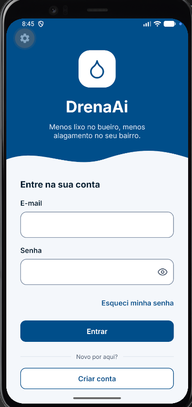
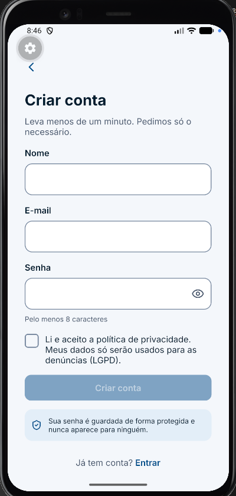
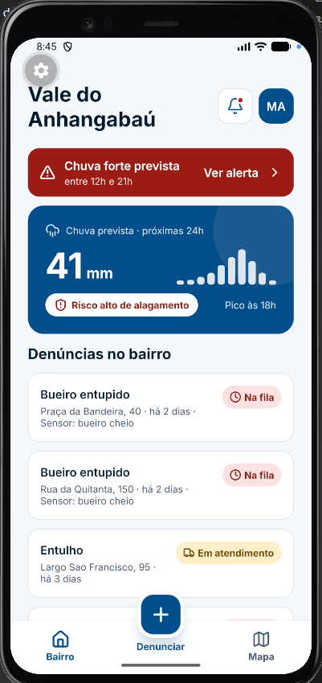
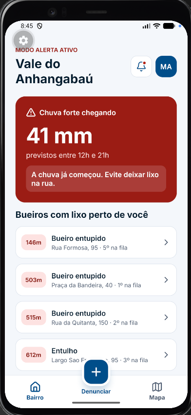
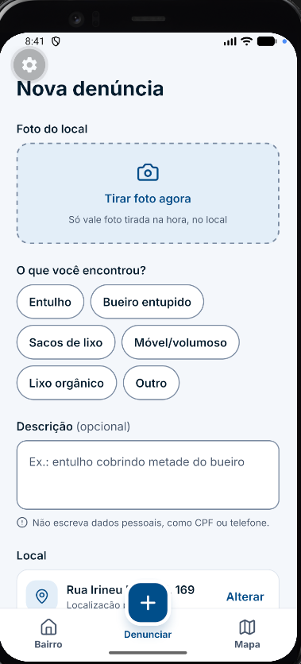
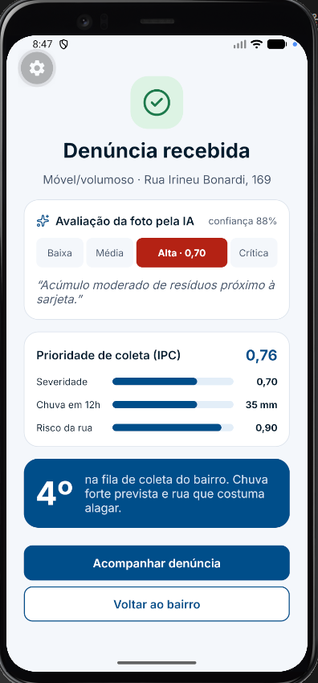
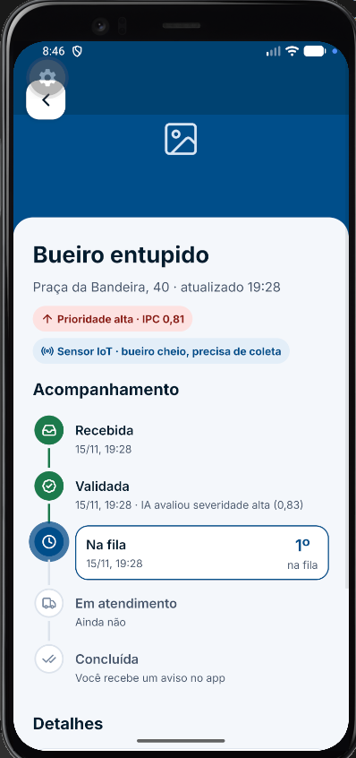
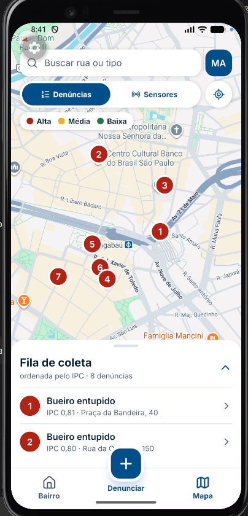
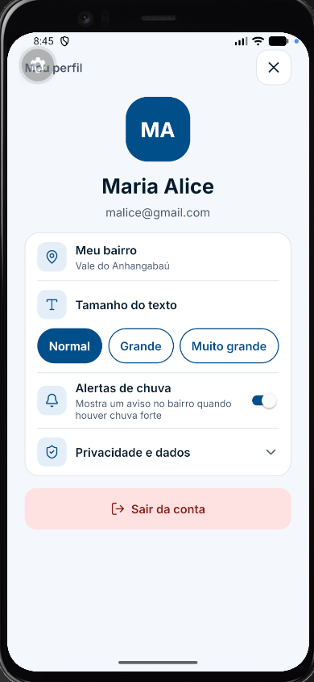

# DrenaAi Mobile

> Menos lixo no bueiro, menos alagamento no seu bairro.

Aplicativo do cidadão da solução **DrenaAi**, feito para a disciplina de **Mobile Development & IoT** da Global Solution 2026.2 (CitizenTech).

## Ficha da CitizenTech

| | |
|---|---|
| **Nome** | DrenaAi |
| **Problema** | A coleta de lixo atende os chamados por ordem de chegada, sem considerar a chuva prevista nem se a rua costuma alagar. Lixo descartado nas calçadas entope bueiros e causa alagamentos, mau cheiro e problemas de mobilidade e saúde. |
| **Quem é beneficiado** | Moradores de bairros que alagam e pedestres que dependem do transporte público e da circulação a pé. |
| **Local** | São Paulo (SP). Bairro piloto: **Vale do Anhangabaú**. |
| **ODS** | **ODS 11** (Cidades e Comunidades Sustentáveis): reduz o impacto do lixo urbano e a exposição a alagamentos. **ODS 13** (Ação contra a Mudança Global do Clima): aumenta a resiliência da cidade a chuvas intensas. |
| **Solução** | O morador denuncia o lixo com foto e localização. A IA avalia a gravidade da foto, o sistema cruza essa gravidade com a chuva prevista e o risco de alagamento da rua, calcula o **Índice de Prioridade de Coleta (IPC)** e reordena a fila de coleta. Sensores ESP32 nos bueiros também abrem ocorrências sozinhos. |
| **Papel do app** | É a porta de entrada do cidadão: denunciar com foto, ver a avaliação da IA e a posição na fila, acompanhar o status, ver o risco de chuva no bairro e consultar a fila e os sensores no mapa. |

**Jornada principal (cenário de referência):** o morador vê um lixo que o sensor não detectou, envia a foto pelo app, a IA avalia a foto e o app mostra a severidade. O sistema cruza a severidade com a chuva prevista e o risco de alagamento da rua, calcula o IPC e reordena a fila. O morador acompanha o status da denúncia no app.

**Fórmula do IPC:** `IPC = 0,4 × Severidade + 0,3 × Chuva (mm em 12h ÷ 50, até 1) + 0,3 × Risco da rua`

## Integrantes

| Nome | RM |
|---|---|
| Maria Alice Freitas Araújo | RM557516 |
| Pedro Henrique Mendes dos Santos | RM555332 |
| João Victor Soave | RM557595 |
| Vinícius Fernandes Tavares Bittencourt | RM558909 |
| Rafael Teofilo Lucena | RM555600 |

## Vídeo

**[Assista ao vídeo no YouTube](LINK_DO_VIDEO)** (até 3 minutos): o app rodando, a jornada principal completa e os dados sendo salvos e recuperados.

## Telas

| Login | Cadastro | Bairro |
|:---:|:---:|:---:|
|  |  |  |
| **Modo alerta** | **Nova denúncia** | **Denúncia recebida** |
|  |  |  |
| **Acompanhamento** | **Mapa** | **Perfil** |
|  |  |  |

## Funcionalidades

- **Login e cadastro**, com aceite da política de privacidade (LGPD).
- **Bairro:** previsão de chuva das próximas 24h, risco de alagamento e lista de denúncias do bairro. Com chuva forte prevista, aparece uma faixa de aviso que abre o **modo alerta**, com contagem regressiva e os bueiros com lixo mais perto.
- **Denunciar:** foto tirada na hora pela câmera, tipo do lixo, descrição opcional e local pelo GPS (ou endereço digitado). Antes de enviar, o app avisa se já existe uma denúncia parecida a até 50 m ("Eu também vi").
- **Denúncia recebida:** severidade dada pela IA, confiança, justificativa, IPC com as três parcelas e posição na fila.
- **Acompanhamento:** linha do tempo com os 5 status (Recebida, Validada, Na fila, Em atendimento, Concluída).
- **Mapa:** pinos numerados pela posição na fila, busca, fila em texto e filtro **Sensores**, com a obstrução e o gás de cada bueiro monitorado pelo ESP32.
- **Perfil:** tamanho do texto (vale para o app inteiro), alertas de chuva e privacidade.

## Banco de dados

**Banco escolhido: Oracle Database, acessado pela API em C# da equipe ([DrenaAi-API](https://github.com/GS-CitizenTech-DrenaAi/DrenaAi-API)).** 
**Por que essa escolha:**
- As denúncias precisam ser **compartilhadas entre todos os moradores** e com a equipe de coleta: a fila de um bairro é a mesma para todo mundo. Um banco só no celular não resolveria isso.
- O cálculo do IPC e a reordenação da fila acontecem no backend, junto com os dados, então a regra é a mesma para todos.
- O Oracle da FIAP é **gratuito** para os alunos, e o backend já usa Entity Framework com migrations (tabelas `TB_DRENA_USUARIO`, `TB_DRENA_OCORRENCIA`, `TB_DRENA_HISTORICO_STATUS` e `TB_DRENA_SENSOR_BUEIRO`).

**O que é salvo e recuperado pelo app:**

| Ação no app | Salva | Recupera |
|---|---|---|
| Criar conta / entrar | `POST /api/auth/cadastro`, `POST /api/auth/login` | Token JWT da sessão |
| Enviar denúncia | `POST /api/ocorrencias` | Severidade, IPC e posição na fila |
| Bairro | | `GET /api/ocorrencias?bairro=` |
| Acompanhamento | | `GET /api/ocorrencias/{id}` (com o histórico de status) |
| Mapa | | `GET /api/fila?bairro=` e `GET /api/telemetria/sensores?bairro=` |

**Camada de acesso aos dados (`src/dados`):** as telas nunca chamam a API diretamente. Todas usam o contrato `DrenaRepo`, que tem duas implementações:
- `ApiRepo.ts`: conversa com a API em C# via `fetch`;
- `mock/MockRepo.ts`: dados simulados, para usar sem o backend.

O arquivo `repo.ts` escolhe qual delas usar a partir do `.env`. Se a API estiver fora do ar, o app oferece entrar no **modo demonstração**.

## De onde vêm os dados

- **Dados reais da solução:** usuários, denúncias, fila e sensores vêm do **Oracle**, pela API em C#. As leituras dos sensores são enviadas pelos ESP32 da equipe para a API.
- **Dados simulados (mock):** a **previsão de chuva** e o aviso de **denúncia parecida por perto** ainda usam dados simulados, em `src/dados/mock/dadosMock.ts`. No modo demonstração, todo o app usa esses dados.
- **Endereços:** logradouros públicos do Vale do Anhangabaú (São Paulo), usados só para posicionar os exemplos no mapa.
- **Nada de dados pessoais reais:** todos os usuários e denúncias de exemplo são fictícios. As descrições passam por um filtro de dados pessoais no backend, e o app avisa o morador para não escrever CPF ou telefone.
- **Mapa:** `react-native-maps`, com os mapas do Google embutidos no Expo Go.

## Como rodar

**Pré-requisitos:** Node.js 20 ou mais novo e o app **Expo Go** no celular ou num emulador Android.

1. Instale as dependências:
   ```bash
   npm install
   ```
2. Crie o arquivo `.env` a partir do exemplo:
   ```bash
   cp .env.example .env
   ```
3. Inicie o app:
   ```bash
   npx expo start
   ```
4. Leia o QR code com o Expo Go ou aperte `a` para abrir no emulador Android.

### Modos de dados (`.env`)

| Variável | Valores | O que faz |
|---|---|---|
| `EXPO_PUBLIC_DATA_MODE` | `mock` (padrão) ou `api` | `mock` usa os dados simulados e funciona sem backend. `api` usa a API em C# e o banco Oracle. |
| `EXPO_PUBLIC_API_URL` | ex.: `http://10.0.2.2:5239` | Endereço da API. `10.0.2.2` é o computador visto de dentro do emulador Android. |

- **Modo `mock`:** entre com `ana@teste.com` e a senha `senha123` (usuária fictícia).
- **Modo `api`:** suba primeiro a [DrenaAi-API](https://github.com/GS-CitizenTech-DrenaAi/DrenaAi-API) seguindo o README dela (`dotnet run --project DrenaAi.Api --launch-profile http`) e crie uma conta pelo próprio app.

O `.env` está no `.gitignore` e **nenhuma senha ou chave fica no app**. As credenciais do banco ficam só no backend, no `appsettings.Development.json`, que também não vai para o repositório.

**Localização no emulador:** para o GPS cair no bairro piloto, abra os controles do emulador (⋯ → Location) e use a latitude `-23.5448` e a longitude `-46.6386` (Av. São João, 290).

## Acessibilidade

- Todos os botões de ícone têm `accessibilityLabel` e `accessibilityRole`, e os itens selecionáveis informam o estado (`selected`, `checked`, `expanded`).
- Status e prioridade **nunca só por cor**: sempre ícone e texto juntos.
- Contraste conferido (padrão AA da WCAG) e alvos de toque com pelo menos 48 pontos.
- **Tamanho do texto ajustável** no Perfil, somado ao tamanho de fonte do celular.
- O mapa tem uma alternativa em texto: a fila completa fica disponível na gaveta, no formato "Prioridade 1, alta: Bueiro entupido".
- Respeita a opção "Remover animações" do Android.
- Linguagem simples, sem termos técnicos.

## Decisões de projeto

- **Foto só pela câmera, na hora:** a denúncia não aceita foto da galeria. Isso dificulta denúncias falsas com fotos antigas ou de outros lugares.
- **O alerta não toma a tela inteira:** o Bairro abre no modo normal e mostra uma faixa quando há chuva forte, para o aviso não virar ruído e continuar sendo levado a sério.
- **Funciona sem backend:** o modo demonstração permite avaliar o app mesmo sem a API rodando.

## Tecnologias

- React Native + **Expo** (SDK 58) + **TypeScript**
- **Expo Router** (rotas por arquivos, abas e rotas protegidas por login)
- `react-native-reanimated` (animações), `react-native-maps` (mapa), `expo-image-picker` (câmera), `expo-location` (GPS)
- `lucide-react-native` (ícones de linha) e fonte Inter
- Tema centralizado em `src/ui/tema.ts`: cores, fontes, alturas de linha e espaçamentos

## Estrutura

```
src/
  app/                 telas (Expo Router)
    (abas)/            Bairro, Denunciar e Mapa
    login.tsx          cadastro.tsx  perfil.tsx
    ocorrencia/[id]    acompanhamento da denúncia
    recebida/[id]      resultado do envio
  dados/               camada de dados
    DrenaRepo.ts       contrato usado pelas telas
    ApiRepo.ts         acesso à API em C# (Oracle)
    mock/              dados simulados
    repo.ts            escolhe API ou mock pelo .env
  estado/              sessão e preferências (Context)
  ui/                  componentes reutilizáveis e tema
```
